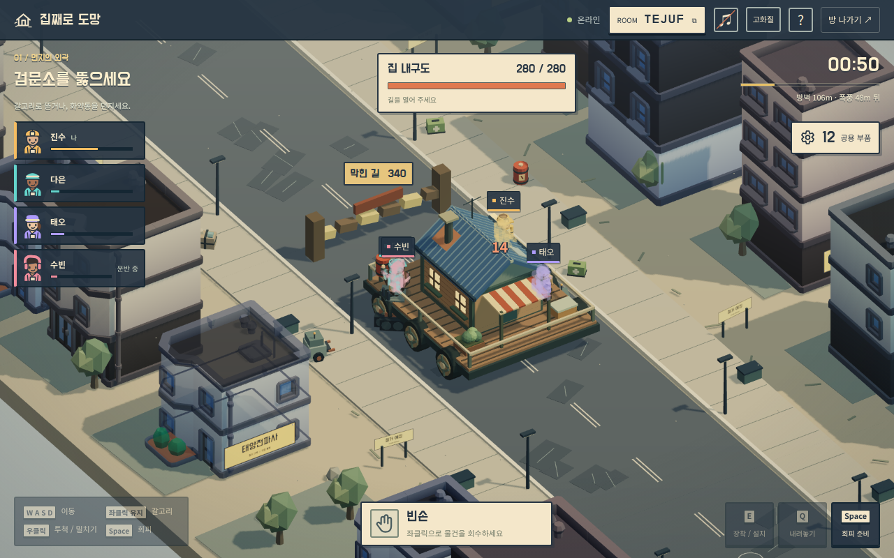
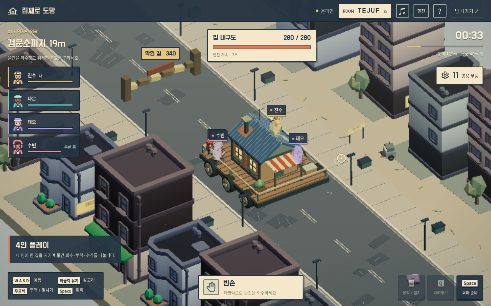
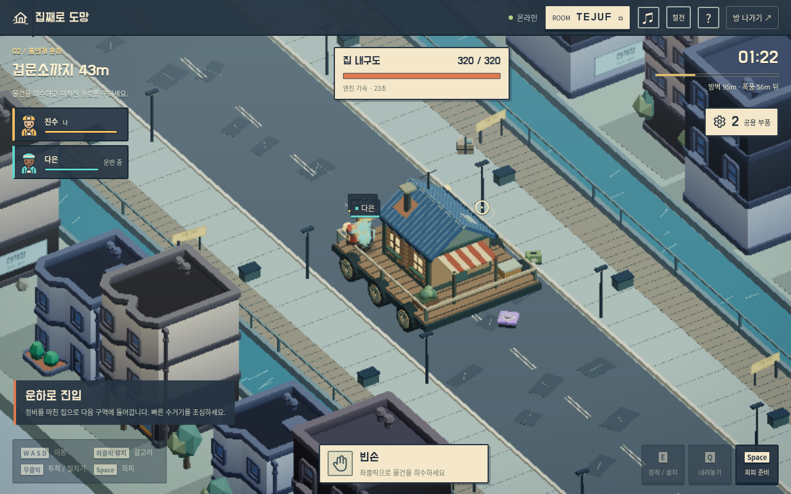
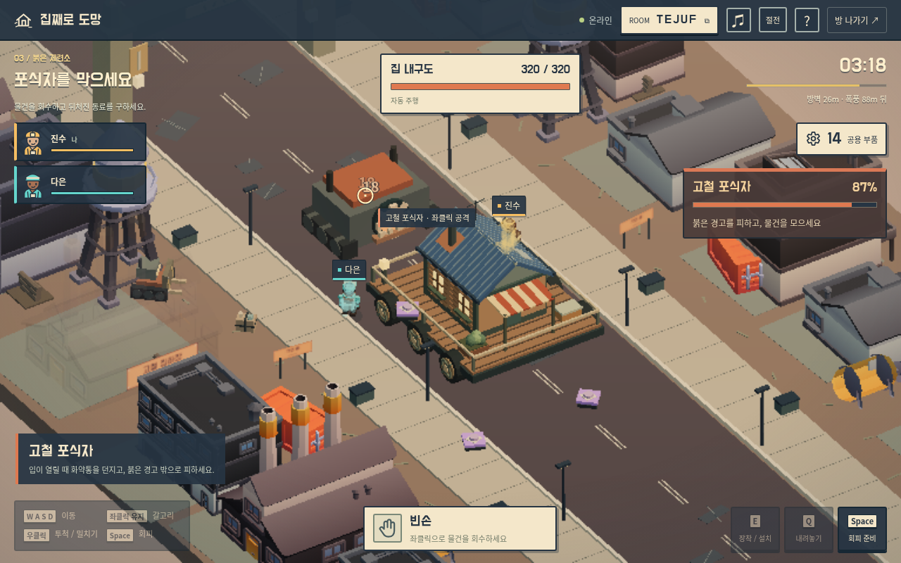
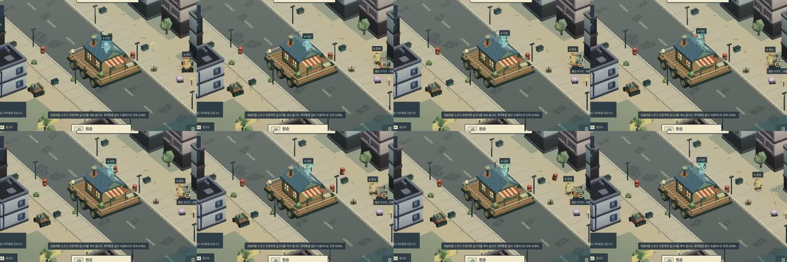
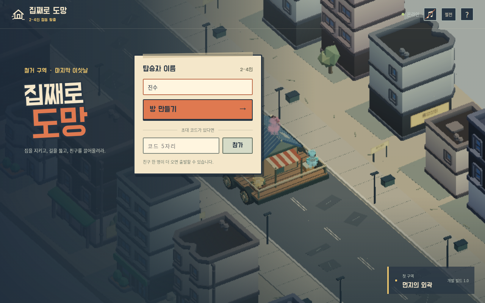

# 실제 실행 캡처

[검증 실행과 영상](https://github.com/sjsr-0401/game-heaven/actions/runs/38870532297)의 캡처입니다. 검토 소스는 `6743bfa`이며, 실제 서버·브라우저·키보드·마우스로 진행했습니다. 2인 원정은 포식자 처치와 탈출까지 완료했습니다.

## 고화질 4인 화면

같은 네 명의 원정에 재접속해 게임의 고화질 모드로 캡처했습니다. 별도로 그린 홍보 이미지가 아닙니다.

## 영상의 녹화 화면

영상은 절전 모드, 1280×800으로 녹화했습니다. 이 실행에서 전장의 평균 렌더링은 2인 15fps, 4인 11fps였습니다. MP4의 25fps 출력과 구분하며, 재생 속도는 1배입니다.

## 투척의 연속 화면

녹화에서 0.167초 간격으로 추출했습니다. 윗줄부터 왼쪽에서 오른쪽으로 읽습니다.

## 시작 화면

자동 키보드·마우스 조작으로 검토했습니다. 사람의 재미 평가와 실제 가정용 인터넷 검증은 별도로 필요합니다. 출처·해시·커밋은 [캡처 기록](screenshots/manifest.json)에 있습니다.
